<!-- ═══════════════════════════ HEADER ═══════════════════════════ -->
<p align="center">
  
</p>

<p align="center">
  
</p>

<p align="center">
  
  
  
</p>

<p align="center">
  <a href="https://github.com/ZeynpGunes"></a>
  <a href="https://github.com/ZeynpGunes?tab=followers"></a>
  <a href="https://github.com/ZeynpGunes?tab=repositories"></a>
  
</p>

<br/>

<!-- ═══════════════════════════ ABOUT ═══════════════════════════ -->
<table>
<tr>
<td width="58%" valign="top">

### 👩‍💻 About Me

I'm a **Software Engineer** focused on **mobile & front-end**, building cross-platform products with **React Native, Flutter and Next.js** — from Figma screens all the way to the **App Store & Google Play**.

I've shipped apps for **social networks, municipalities, care homes, factories, fintech, fitness, e-commerce and AI video** — each with its own real-world challenge.

- 📱 Currently **Mobile Developer @ I See U Technologies**
- 🧩 Large-scale apps: **feature-sliced architecture**, thousands of TS files, **28 languages**
- 🛡️ Native power when needed: **Kotlin & Swift** bridges, CallKit, WidgetKit
- 💳 Payments & identity: **RevenueCat, Iyzico, SEPA, Sumsub KYC**
- 👩‍🏫 **Team lead & mentor** — taught React Native to university students
- 🎓 **MSc in Digital Forensic Engineering** · GPA 3.92 / 4.00

</td>
<td width="42%" valign="top">

```yaml
name:     Zeynep Güneş
role:     Software Engineer
focus:    Mobile & Front-End
now:      I See U Technologies
mobile:   [React Native, Flutter, Expo]
web:      [React, Next.js]
state:    [Redux Toolkit, RTK Query,
           React Query, BLoC/Cubit]
native:   [Kotlin, Swift]
domains:  [Social, Health, IoT,
           FinTech, GovTech, E-com]
motto:    "Ship fast. Ship beautiful."
```

</td>
</tr>
</table>

<!-- ═══════════════════════════ STACK ═══════════════════════════ -->
## 🛠️ Tech Stack

<p align="center"><b>📱 Mobile</b></p>
<p align="center">
  
</p>

<p align="center"><b>🌐 Front-End</b></p>
<p align="center">
  
</p>

<p align="center"><b>🗄️ State · Data · Tools</b></p>
<p align="center">
  
</p>

<details>
<summary><b>📋 Full toolbox (click to expand)</b></summary>
<br/>

| Category | Technologies |
|:--|:--|
| **Mobile** | React Native · Expo (Prebuild) · Flutter · Dart · React Navigation · GoRouter |
| **Native** | Kotlin · Swift · Method Channels · Android Call Screening · CallKit · WidgetKit · App Groups |
| **State Management** | Redux Toolkit · RTK Query · React Query · MobX · Context API · BLoC / Cubit |
| **Networking** | Axios · Dio · RESTful APIs · WebSocket · Firebase Realtime |
| **Storage** | Firebase Firestore · SQLite · SQLCipher · MMKV · SecureStore · AsyncStorage |
| **Web** | React · Next.js · TypeScript · JavaScript (ES6+) · HTML5 · CSS3 · SCSS · Tailwind CSS |
| **Payments & Identity** | RevenueCat · Iyzico · SEPA / IBAN · Sumsub (KYC) |
| **Device & Maps** | Google Maps · Location · Geofencing · Camera · Snap Camera Filters · NFC · QR Scanner · Face Recognition |
| **Quality & Delivery** | Sentry · FCM Push · Deep Links · CI/CD · App Store Connect · Google Play Console |
| **Data Viz** | Victory Native · Chart Kit · ECharts · Chart.js · react-native-svg |
| **Architecture** | Feature-Sliced · Feature-Repository · i18n (28 languages) |
| **Collaboration** | Jira · Confluence · Trello · Slack · Figma · Postman · GitHub · GitLab |

</details>

<!-- ═══════════════════════════ EXPERIENCE ═══════════════════════════ -->
## 💼 Experience

<table>
<tr>
<td width="50%" valign="top">

#### 📱 I See U Technologies
**Mobile Developer** · Dubai · *Present*

Building **ISeeU** (social platform) with React Native and **AnrufBlocker** (spam-call protection) with Flutter for iOS & Android — from architecture to store releases.

</td>
<td width="50%" valign="top">

#### 🚀 Smartup Network
**Frontend & Mobile Developer** · İstanbul

Delivered mobile & web products across loyalty, e-commerce, sports, fitness, food delivery and AI video. Mentored junior developers and owned release processes.

</td>
</tr>
<tr>
<td width="50%" valign="top">

#### 🏭 Prodrom ICT Solutions
**Mobile Developer** · Elazığ

Built mobile apps for healthcare, municipalities and industrial IoT. **Team Lead** on CyberCortex; ran code reviews, sprint planning and mentoring.

</td>
<td width="50%" valign="top">

#### 👩‍🏫 SERKA – CODE23
**Mobile Development Instructor** · Elazığ

Designed and taught a two-month React Native program for university students — from component architecture to their first production-ready apps.

</td>
</tr>
</table>

<!-- ═══════════════════════════ PROJECTS ═══════════════════════════ -->
## 🌟 Featured Work

<table>
<tr>
<td width="50%" valign="top">

### 💬 ISeeU
All-in-one social app: posts & stories, map-based discovery of nearby people, real-time chat, gifts and in-app purchases. Feature-sliced codebase with **thousands of TypeScript files** and **28 languages**.


<a href="https://play.google.com/store/apps/details?id=com.iseeu.mobile"></a>

</td>
<td width="50%" valign="top">

### 🛡️ AnrufBlocker
Flutter app that shields users from spam & scam calls with **native call blocking** (Android Call Screening + iOS CallKit via Kotlin/Swift), encrypted local DB, family tracking with geofencing and subscription plans.


</td>
</tr>
<tr>
<td width="50%" valign="top">

### 🏛️ Maltepem
Official app of **Maltepe Municipality** — residents snap & send city issues, join surveys and follow local events and announcements.


<a href="https://play.google.com/store/apps/details?id=com.maltepebelediyesi.maltepem"></a>

</td>
<td width="50%" valign="top">

### 🛒 Sporday
Multi-vendor sports marketplace on **Next.js** — product & vendor pages, cart, coupons, Iyzico payments and seller dashboards.


<a href="https://sporday.com/"></a>

</td>
</tr>
<tr>
<td width="50%" valign="top">

### 🎬 Syntonym Blur
AI-powered video & image anonymization — upload, face/plate detection editor, blur masking, trimming and export flows.


<a href="https://blur.syntonym.com/"></a>

</td>
<td width="50%" valign="top">

### 📡 ProKart
IoT app that predicts equipment failures from temperature, dust & vibration sensors — live charts, NFC/QR device setup and remote power control.


<a href="https://prokart.prodrom.com/"></a>

</td>
</tr>
</table>

<details>
<summary><b>📂 More shipped products (click to expand)</b></summary>
<br/>

| Project | What it does | Stack | Link |
|:--|:--|:--|:--|
| 🏥 **BakımEvi** | Patient admissions, medication & treatment tracking for care facilities | React Native · SQLite | — |
| 🏭 **ProEndX** | Real-time production tracking with QR job control & role-based dashboards | Expo · Charts | [Website](https://www.proendx.com/) |
| 👕 **ProFabric** | Garment factory app with face-recognition login & live performance charts | React Native | [Website](http://profabric.prodrom.com/) |
| 📈 **Algofin** | Stock tracking, sentiment, technical & fundamental analysis | React Native | [Website](https://algofin.prodrom.com/) |
| 🔒 **CyberCortex** | CVE-based vulnerability analytics for network devices — *Team Lead* | React Native | — |
| 🤖 **AutoML** | ML-based intrusion alerts & device management for factory networks | React Native · NFC | — |
| 🔧 **Bakım Yönetim** | Maintenance tasks & fault alerts with QR device tracking | React Native | — |
| 🏋️ **Kuka** | Trainer–client session booking, attendance & progress | React Native · Web | [Website](https://kukaonline.com/) |
| ☕ **Kupa** | QR loyalty & rewards with map-based café discovery | React Native · Maps | [Google Play](https://play.google.com/store/apps/details?id=com.kupa.app) |
| ⚽ **Sportizm** | Book pitches, find players and organise matches | React Native | — |
| 🍔 **BizimSepet** | Food ordering with live order tracking & coupons | React Native · Firebase | — |
| 🏷️ **Price Match** | Gamified price-guessing challenge with tokens | React Native | — |
| 🐾 **Petsomy** | Location-based directory for vets, pet shops & pet hotels | React Native | — |

</details>

<!-- ═══════════════════════════ EDUCATION & CERTS ═══════════════════════════ -->
## 🎓 Education & Certifications

<table>
<tr>
<td width="50%" valign="top">

**🎓 Fırat University**
- **MSc** · Digital Forensic Engineering · GPA **3.92**
- **BSc** · Digital Forensic Engineering

</td>
<td width="50%" valign="top">

**📜 Certifications**
- ☁️ Huawei Cloud HCCDA – Tech Essentials
- 🛡️ CNNS – Certified Network Security Specialist (ICSI)
- 🔍 AccessData Certified Investigator
- 🧪 Autopsy Basics & Hands-On (BasisTech)
- 🔐 Fortinet NSE 1 – NSE 2
- 💡 KOSGEB Advanced Entrepreneurship

</td>
</tr>
</table>

<!-- ═══════════════════════════ OPEN SOURCE ═══════════════════════════ -->
## 🧪 On GitHub

| Repo | About |
|:--|:--|
| 🏙️ [Cityscapes-Segmentasyon](https://github.com/ZeynpGunes/Cityscapes-Segmentasyon) | Semantic segmentation of city streets with deep learning (Python) |
| 🔐 [next-auth](https://github.com/ZeynpGunes/next-auth) | Authentication flows with Next.js |
| 🔥 [react-native-firebase](https://github.com/ZeynpGunes/react-native-firebase) | Firebase for React Native (fork) |

<!-- ═══════════════════════════ STATS ═══════════════════════════ -->
## 📊 GitHub Analytics

<p align="center">
  
  
</p>

<p align="center">
  
</p>

<p align="center">
  
  
  
</p>

<!-- ═══════════════════════════ SNAKE ═══════════════════════════ -->
## 🐍 Contribution Snake

<p align="center">
  <picture>
    <source media="(prefers-color-scheme: dark)" srcset="https://raw.githubusercontent.com/ZeynpGunes/ZeynpGunes/output/github-contribution-grid-snake-dark.svg"/>
    <source media="(prefers-color-scheme: light)" srcset="https://raw.githubusercontent.com/ZeynpGunes/ZeynpGunes/output/github-contribution-grid-snake.svg"/>
    
  </picture>
</p>

<!-- ═══════════════════════════ CONTACT ═══════════════════════════ -->
## 🤝 Let's Build Something Great

<p align="center">
  <a href="https://www.linkedin.com/in/zeynep-g%C3%BCne%C5%9F-b93773164/"></a>
  <a href="mailto:guns.zeynp@gmail.com"></a>
  <a href="https://github.com/ZeynpGunes"></a>
</p>

<p align="center"><i>“Great apps aren’t built in a day — they’re built one smooth screen at a time.”</i></p>

<!-- ═══════════════════════════ FOOTER ═══════════════════════════ -->
<p align="center">
  
</p>
